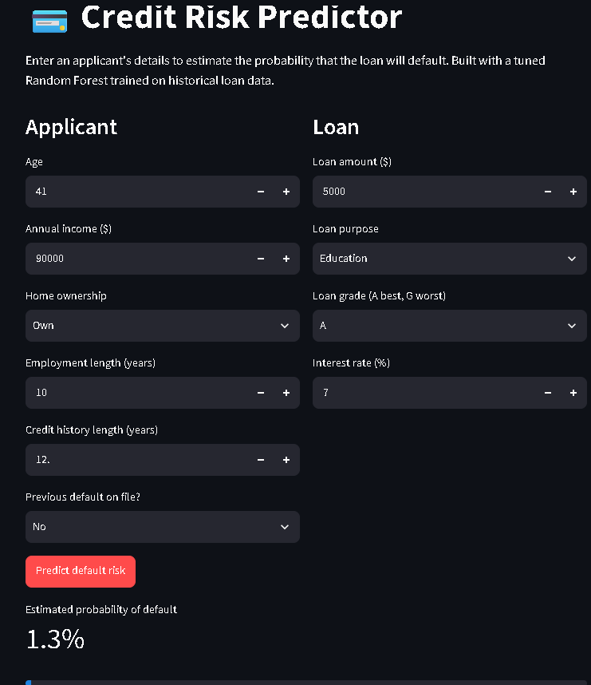
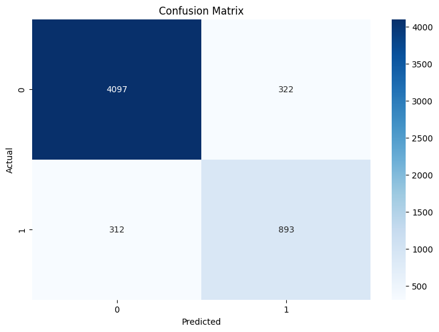
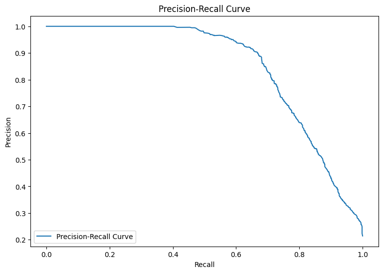
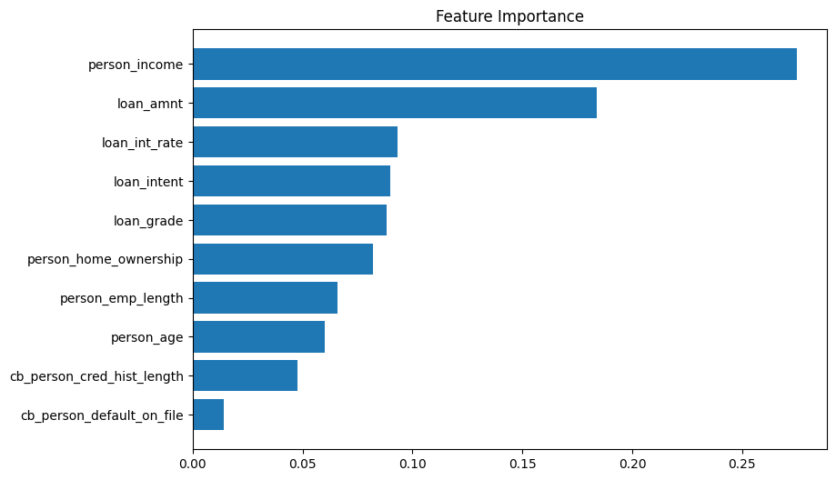

# Credit Risk Prediction

A machine learning model that estimates the probability a loan applicant will default, with an interactive web app for trying it out.

**Live demo:** https://credit-risk-prediction-xsm9tmmnd8gxkixqihejkg.streamlit.app/


.
## The problem

Lenders lose money when borrowers default, but turning away good borrowers also costs them business. This project predicts default risk from an applicant's profile and loan details, so a lender can flag high-risk applications for review.

## Results

Evaluated on a held-out test set of 5,624 loans, of which 1,205 (about 21%) defaulted.

| Decision threshold | Accuracy | Defaulter precision | Defaulter recall | Defaulter F1 |
|---|---|---|---|---|
| 0.5 (default) | 0.89 | 0.74 | 0.75 | 0.74 |
| 0.6 | 0.90 | 0.81 | 0.71 | 0.76 |

**ROC-AUC: 0.91** (0.914 when the app's pipeline is retrained with `train_model.py`; the original notebook run, shown in the chart below, reports 0.92)

### Model performance charts

The charts below come from the original notebook run on the same 5,624-loan test set.

**Confusion matrix at the default 0.5 threshold.** Of 1,205 actual defaulters, the model catches 893 (74%) and misses 312. It also flags 322 borrowers who would have repaid.



**ROC curve.** The curve stays well above the diagonal (random guessing), with an AUC of 0.92 in this run.


**Precision-recall curve.** Defaulters are the minority class (about 21%), so this view is more informative than ROC. Precision stays high until recall passes about 0.6, then falls steadily. That is the trade-off behind the threshold choice.



**Feature importance (Random Forest).** Income and loan amount matter most, followed by interest rate, loan purpose and loan grade. These importances show what the model relies on, not what causes default.



### Why two thresholds?

At 0.6 the model is more cautious about labelling someone a defaulter. It raises precision (81% of flagged applicants really default) but misses more actual defaulters (recall falls from 75% to 71%). Which is better depends on the lender: if a missed default costs far more than a rejected good applicant, the lower threshold is safer. The app uses 0.6 as its cut-off, and the probability is always shown so the cut-off can be changed.

## Approach

1. **Cleaning and preparation:** cleaned the raw data and encoded categorical features as integers (`ml_data.csv`).
2. **Class imbalance:** defaulters are the minority, so the training set was balanced with SMOTE (applied to training data only, never the test set).
3. **Scaling:** standardised features with `StandardScaler`.
4. **Modeling:** compared models and tuned a Random Forest with `GridSearchCV` (300 trees, max depth 30, no bootstrap).
5. **Deployment:** saved the scaler and model together as one scikit-learn Pipeline and built a Streamlit app around it.

## Features

Age, income, home ownership, employment length, loan purpose, loan grade, loan amount, interest rate, previous default on file, and credit history length.

## Run it locally

```bash
git clone https://github.com/Davidkamiti/credit-risk-prediction.git
cd credit-risk-prediction
pip install -r requirements.txt
streamlit run app.py
```

To retrain the model from the data (also needs `imbalanced-learn`):

```bash
pip install imbalanced-learn
python train_model.py
```

## Repository contents

| File | Purpose |
|---|---|
| `Modeling.ipynb` | Model building, tuning and evaluation |
| `ml_data.csv` | Cleaned, encoded dataset used for training |
| `train_model.py` | Rebuilds the model and saves it with its scaler |
| `app.py` | Streamlit web app |
| `model/` | Saved model and decision threshold |
| `images/` | Charts used in this README |
| `requirements.txt` | Dependencies for the app |

## Limitations and what I would do next

- **Threshold chosen on the test set.** I compared thresholds using the same data I report results on, which slightly flatters the 0.6 numbers. A separate validation set would be cleaner.
- **Cross-validation and SMOTE.** I balanced the data before cross-validating, so synthetic samples can appear in both training and validation folds and inflate cross-validation scores. The next step is an `imblearn` Pipeline that applies SMOTE inside each fold.
- **Loan grade and interest rate** are assigned by the lender using its own risk assessment, so the model partly learns the lender's existing judgment. A version without them would show how much the model finds on its own.
- **Interest rates are stored as whole numbers** in the training data, so the app asks for a whole-number rate.
- **Not a lending tool.** The model is trained on a public dataset and is a portfolio demonstration only.
- Further ideas: feature importance and SHAP explanations in the app, and comparing against gradient boosting models.

## Tech stack

Python, pandas, NumPy, scikit-learn, imbalanced-learn, Streamlit

## Author

David Kamiti | [GitHub](https://github.com/Davidkamiti)
